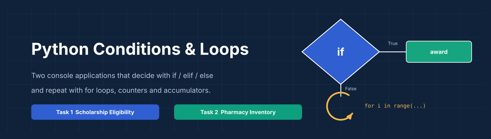
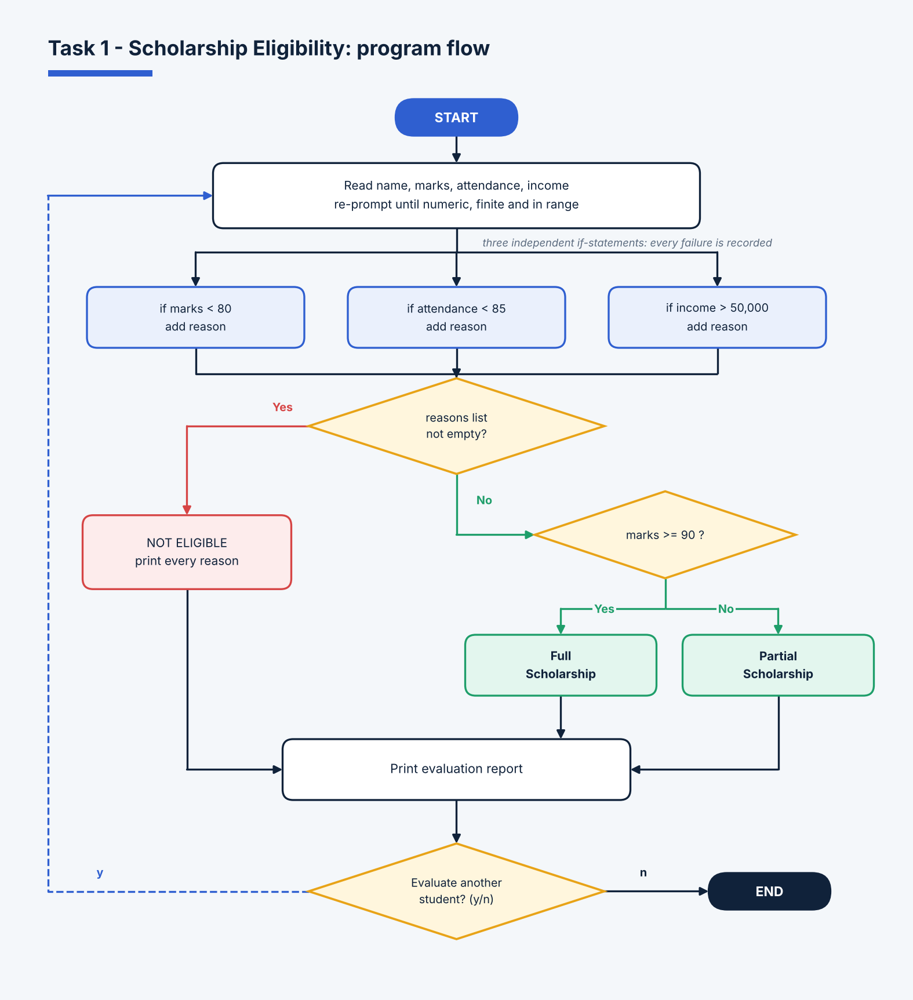
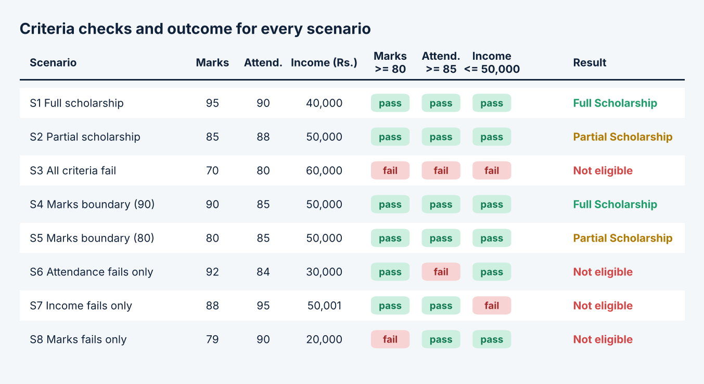
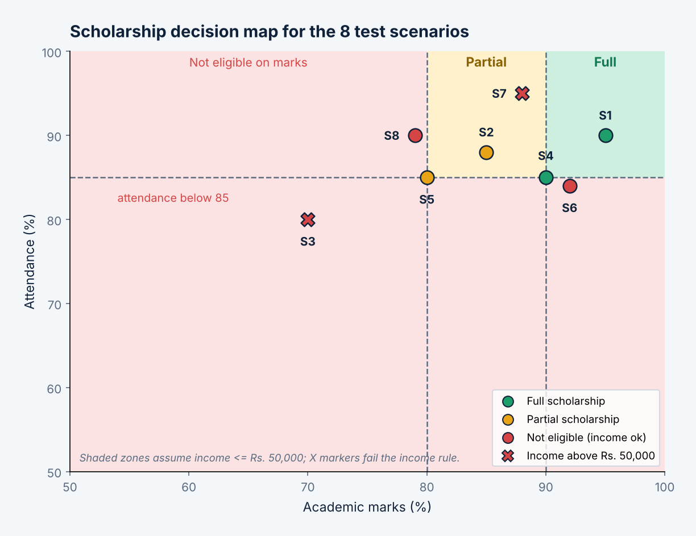
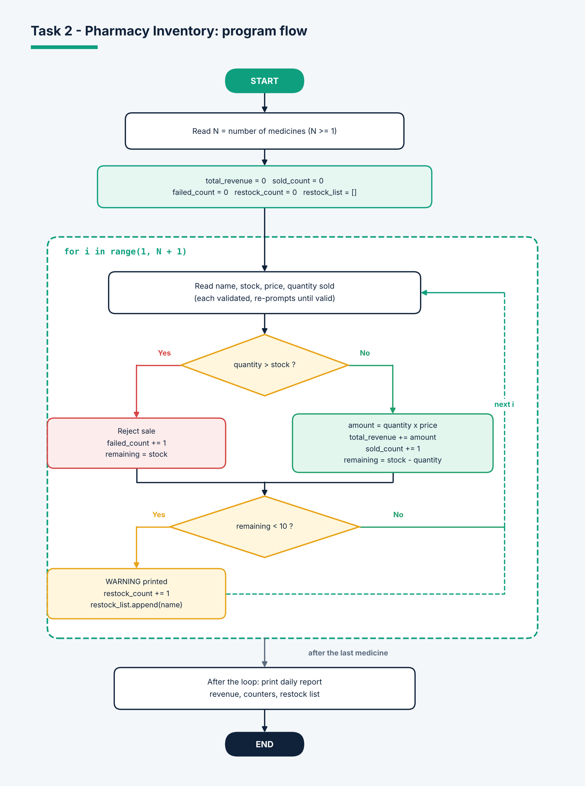
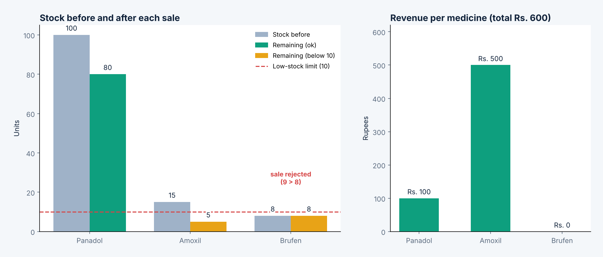
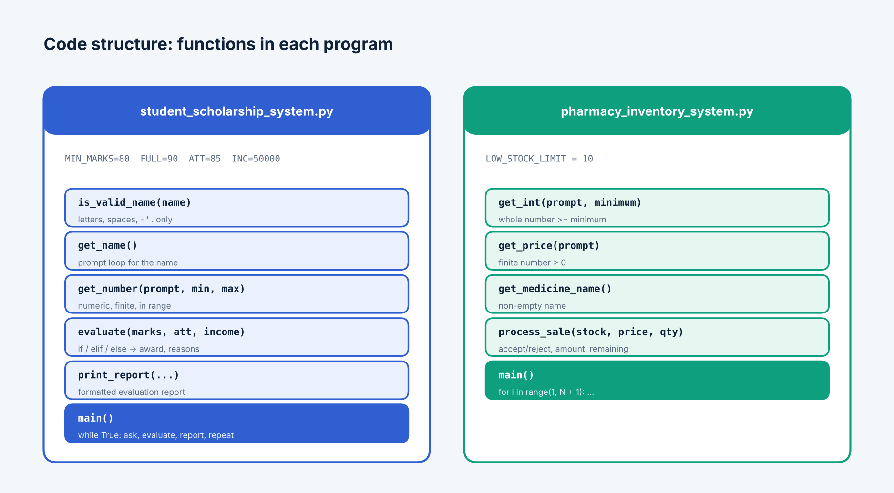
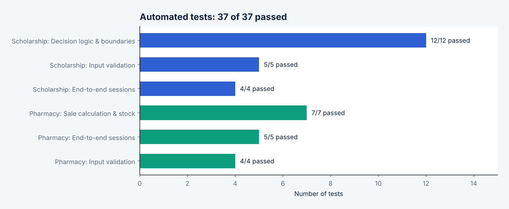

<p align="center">
  
</p>

<h1 align="center">Python Conditions &amp; Loops Assessment</h1>

<p align="center">
  
  
  
  
</p>

<p align="center">
  <b>Two console applications that decide with <code>if / elif / else</code> and repeat with <code>for</code> loops.</b><br>
  <a href="#live-preview">Live preview</a> ·
  <a href="#requirements-and-how-each-is-met">Requirements</a> ·
  <a href="#testing-and-verification">Testing</a> ·
  <a href="#how-to-run">How to run</a> ·
  <a href="#references">References</a>
</p>

---
[](https://laiba-shehbaz.github.io/python-conditions-loops-assessment/preview.html)

---

## Table of contents

1. [Overview](#overview)
2. [Requirements and how each is met](#requirements-and-how-each-is-met)
3. [Project structure](#project-structure)
4. [Methodology](#methodology)
5. [Application 1: Student Scholarship Eligibility System](#application-1-student-scholarship-eligibility-system)
6. [Application 2: Smart Pharmacy Inventory & Sales Management System](#application-2-smart-pharmacy-inventory--sales-management-system)
7. [Code structure](#code-structure)
8. [Python concepts used](#python-concepts-used)
9. [Testing and verification](#testing-and-verification)
10. [Review findings and fixes](#review-findings-and-fixes)
11. [Assumptions and limitations](#assumptions-and-limitations)
12. [How to run](#how-to-run)
13. [Regenerating the results and images](#regenerating-the-results-and-images)
14. [Publish the preview](#publish-the-preview)
15. [References](#references)

---

## Overview

| | Task 1 | Task 2 |
|---|--------|--------|
| **Program** | [`student_scholarship_system.py`](student_scholarship_system.py) | [`pharmacy_inventory_system.py`](pharmacy_inventory_system.py) |
| **Topic** | Conditional statements | Loop structures |
| **Problem** | Decide whether a student earns a *Full* or *Partial* scholarship, or is *not eligible*, and explain why | Process sales for several medicines, update stock, warn about low stock and print a daily report |
| **Key constructs** | `if` / `elif` / `else`, comparison operators, validation loops | `for` + `range()`, counters, an accumulator, conditions inside a loop |
| **Test status** | 21 automated tests passing | 16 automated tests passing |

Both programs use **only the Python standard library**. Every number, transcript and chart in this document was produced by running the code in this repository (see [Regenerating the results and images](#regenerating-the-results-and-images)).

> **About the requirements.** The submitted archive contained the two programs and a starter README but no separate assignment brief. The requirements below are therefore taken from the behaviour that README and the programs' own docstrings describe, and each one is checked by an automated test.

---

## Requirements and how each is met

### Task 1: Student Scholarship Eligibility System (conditional statements)

| # | Requirement | Implementation | Verified by |
|---|-------------|----------------|-------------|
| 1.1 | Collect name, marks, attendance and monthly family income | `get_name()`, `get_number()` called from `main()` | `TestEndToEnd` |
| 1.2 | Validate the input and re-prompt on bad values | Numeric, finite and range checks in `get_number()`; letters-only check in `is_valid_name()` | `TestValidation` |
| 1.3 | Eligible only if marks ≥ 80, attendance ≥ 85 and income ≤ Rs. 50,000 | Three independent `if` statements in `evaluate()` | `TestEvaluate` boundary tests |
| 1.4 | Eligible with marks ≥ 90 gives **Full Scholarship** | `elif marks >= FULL_SCHOLARSHIP` | `test_marks_exactly_90_is_full` |
| 1.5 | Eligible with marks 80 to 89 gives **Partial Scholarship** | final `else` branch | `test_marks_just_below_90_is_partial` |
| 1.6 | Otherwise **not eligible**, listing **every** failed criterion | All failures are appended to `reasons` before the decision | `test_all_three_criteria_fail` |
| 1.7 | Print a complete evaluation report | `print_report()` | `TestEndToEnd` |
| 1.8 | Evaluate several students in one run | `while True` loop in `main()` with a `y/n` prompt | `test_evaluates_multiple_students_in_one_run` |

### Task 2: Smart Pharmacy Inventory & Sales Management System (loops)

| # | Requirement | Implementation | Verified by |
|---|-------------|----------------|-------------|
| 2.1 | Ask how many medicines to process (at least 1) | `get_int(..., 1)` | `test_get_int_reprompts` |
| 2.2 | Process each medicine with a `for` loop using `range()` | `for i in range(1, total_medicines + 1)` | `test_loop_runs_exactly_n_times` |
| 2.3 | Collect name, stock, price per unit and quantity sold | `get_medicine_name()`, `get_int()`, `get_price()` | `TestValidation` |
| 2.4 | Reject a sale when quantity sold exceeds stock | `process_sale()` returns `accepted = False` | `test_rejected_sale_keeps_stock_and_earns_nothing` |
| 2.5 | Otherwise compute the sale amount and remaining stock | `quantity * price`, `stock - quantity` | `test_successful_sale` |
| 2.6 | Warn when remaining stock is below 10 | `remaining < LOW_STOCK_LIMIT` | `test_low_stock_boundary` |
| 2.7 | Keep a revenue accumulator and a restock counter | `total_revenue += ...`, `restock_count += 1` | `test_revenue_sums_across_medicines` |
| 2.8 | Final report: processed, successful, rejected, revenue, restock count and names | Report block at the end of `main()` | `test_readme_scenario_totals` |

---

## Project structure

```
python-conditions-loops-assessment/
├── README.md                          # this document
├── index.html                         # self-contained interactive preview (live terminals, animated flowcharts)
├── student_scholarship_system.py      # Task 1
├── pharmacy_inventory_system.py       # Task 2
├── requirements.txt                   # only needed to regenerate the images
├── assets/                            # banner, flowcharts, charts, diagrams (PNG)
│   ├── banner.png
│   ├── flowchart_scholarship.png
│   ├── flowchart_pharmacy.png
│   ├── architecture.png
│   ├── chart_decision_map.png
│   ├── chart_criteria_matrix.png
│   ├── chart_pharmacy.png
│   └── chart_tests.png
├── tests/                             # 37 unittest tests (standard library)
│   ├── test_scholarship.py
│   └── test_pharmacy.py
├── scripts/                           # reproducibility tooling
│   ├── run_scenarios.py               # runs the programs, records real output
│   ├── generate_visuals.py            # builds every image from that output
│   ├── build_preview.py               # builds index.html
│   └── preview_template.html
└── docs/outputs/                      # recorded transcripts and results.json
```

---

## Methodology

1. **Read the requirements** from the starter README and docstrings and turn each into a numbered, testable statement (see the tables above).
2. **Map the control flow.** The two flowcharts ([Task 1](#program-flow), [Task 2](#program-flow-1)) document how each program decides and repeats. They make the one design question that matters in Task 1 explicit: the three criteria must be checked **independently**, not in an `if / elif` chain, otherwise only the first failure would be reported.
3. **Implement in small functions.** Input, validation, decision logic and reporting are separate, so the decision logic (`evaluate`, `process_sale`) is pure and easy to test.
4. **Validate at the boundary.** Every `input()` is wrapped in a loop that re-prompts until the value is valid, so the rest of the program can trust its data.
5. **Test.** 37 automated tests cover exact boundaries (79.99, 80, 89.99, 90, 84.99, 85, 50,000, 50,001), bad input and complete simulated sessions.
6. **Record real output.** `scripts/run_scenarios.py` runs the programs on fixed scenarios and saves the transcripts and results to `docs/outputs/`.
7. **Visualise from the recorded data.** `scripts/generate_visuals.py` draws every chart from `results.json`, so no figure is typed in by hand.

### Key design decisions

| Decision | Reason |
|----------|--------|
| Thresholds are named constants | A rule change (for example a new income limit) is a one-line edit. |
| Criteria are three separate `if` statements | Reports *all* failed criteria in one pass, as required. |
| `evaluate()` and `process_sale()` return values instead of printing | Pure functions are trivial to unit-test and keep I/O in `main()`. |
| `nan` and `inf` are rejected | `float("nan")` is accepted by `float()` but compares `False` to everything (see [Review findings](#review-findings-and-fixes)). |
| A rejected sale leaves stock unchanged and still gets the low-stock check | Nothing was sold, so stock is what it was; if that is already below 10 the pharmacy still needs to restock. |
| A quantity of 0 is accepted | A medicine can legitimately have no sales in a day; it counts as a successful sale of Rs. 0.00. |

---

## Application 1: Student Scholarship Eligibility System

### Rules

| Criterion | Requirement | Constant |
|-----------|-------------|----------|
| Academic marks | at least 80 % | `MIN_MARKS = 80` |
| Attendance | at least 85 % | `MIN_ATTENDANCE = 85` |
| Monthly family income | at most Rs. 50,000 | `MAX_INCOME = 50000` |
| Full scholarship | all criteria met **and** marks ≥ 90 % | `FULL_SCHOLARSHIP = 90` |
| Partial scholarship | all criteria met and marks 80 to 89 % | (else branch) |
| Not eligible | any criterion fails; each failure is listed | |

### Program flow

<p align="center"></p>

### The decision logic

```python
def evaluate(marks, attendance, income):
    """Return (scholarship_type, list_of_reasons_for_ineligibility)."""
    reasons = []

    # Check each criterion independently so ALL failures are reported
    if marks < MIN_MARKS:
        reasons.append(f"Marks ({marks:.1f}%) are below the required {MIN_MARKS}%.")
    if attendance < MIN_ATTENDANCE:
        reasons.append(f"Attendance ({attendance:.1f}%) is below the required {MIN_ATTENDANCE}%.")
    if income > MAX_INCOME:
        reasons.append(f"Monthly family income (Rs. {format_rupees(income)}) exceeds Rs. {MAX_INCOME:,}.")

    # Decide the scholarship type
    if reasons:
        return "None", reasons
    elif marks >= FULL_SCHOLARSHIP:
        return "Full Scholarship", reasons
    else:  # marks are 80 to just under 90
        return "Partial Scholarship", reasons
```

Because the three checks are independent `if` statements, a student who fails all of them sees **three** reasons, not just the first one.

### Results: 8 scenarios, run through the real `evaluate()` function

| ID | Scenario | Marks | Attendance | Income (Rs.) | Marks ≥ 80 | Attend. ≥ 85 | Income ≤ 50,000 | Result |
|----|----------|------:|-----------:|-------------:|:---:|:---:|:---:|--------|
| S1 | Full scholarship | 95 | 90 | 40,000 | pass | pass | pass | **Full Scholarship** |
| S2 | Partial scholarship | 85 | 88 | 50,000 | pass | pass | pass | **Partial Scholarship** |
| S3 | All criteria fail | 70 | 80 | 60,000 | **fail** | **fail** | **fail** | **Not eligible** |
| S4 | Marks boundary (90) | 90 | 85 | 50,000 | pass | pass | pass | **Full Scholarship** |
| S5 | Marks boundary (80) | 80 | 85 | 50,000 | pass | pass | pass | **Partial Scholarship** |
| S6 | Attendance fails only | 92 | 84 | 30,000 | pass | **fail** | pass | **Not eligible** |
| S7 | Income fails only | 88 | 95 | 50,001 | pass | pass | **fail** | **Not eligible** |
| S8 | Marks fails only | 79 | 90 | 20,000 | **fail** | pass | pass | **Not eligible** |

<p align="center"></p>

S4 and S5 sit exactly on the thresholds (marks 90 and 80, attendance 85, income 50,000) and are **eligible**, confirming that the comparisons are inclusive (`>=` and `<=`).

<p align="center"></p>

### Sample session: three students in one run

```text
=== Student Scholarship Eligibility System ===

Enter student name: ali khan
Enter academic marks (%): 95
Enter attendance percentage (%): 90
Enter monthly family income (Rs.): 40000

====================================================
        SCHOLARSHIP EVALUATION REPORT
====================================================
Student Name          : Ali Khan
Academic Marks        : 95.0%   (min 80%)
Attendance            : 90.0%   (min 85%)
Monthly Family Income : Rs. 40,000   (max Rs. 50,000)
----------------------------------------------------
Status                : ELIGIBLE
Scholarship Awarded   : Full Scholarship
====================================================

Evaluate another student? (y/n): y

Enter student name: bilal
Enter academic marks (%): 70
Enter attendance percentage (%): 80
Enter monthly family income (Rs.): 60000

====================================================
        SCHOLARSHIP EVALUATION REPORT
====================================================
Student Name          : Bilal
Academic Marks        : 70.0%   (min 80%)
Attendance            : 80.0%   (min 85%)
Monthly Family Income : Rs. 60,000   (max Rs. 50,000)
----------------------------------------------------
Status                : NOT ELIGIBLE
Reason(s):
  - Marks (70.0%) are below the required 80%.
  - Attendance (80.0%) is below the required 85%.
  - Monthly family income (Rs. 60,000) exceeds Rs. 50,000.
====================================================

Evaluate another student? (y/n): y

Enter student name: sara noor
Enter academic marks (%): 85
Enter attendance percentage (%): 88
Enter monthly family income (Rs.): 50000

====================================================
        SCHOLARSHIP EVALUATION REPORT
====================================================
Student Name          : Sara Noor
Academic Marks        : 85.0%   (min 80%)
Attendance            : 88.0%   (min 85%)
Monthly Family Income : Rs. 50,000   (max Rs. 50,000)
----------------------------------------------------
Status                : ELIGIBLE
Scholarship Awarded   : Partial Scholarship
====================================================

Evaluate another student? (y/n): n
Goodbye!
```

### Sample session: invalid input is rejected and re-prompted

```text
=== Student Scholarship Eligibility System ===

Enter student name: ali123
  Invalid name. Use letters, spaces, hyphens or apostrophes only.
Enter student name: ali khan
Enter academic marks (%): abc
  Invalid input. Please enter a number.
Enter academic marks (%): 150
  Value must be between 0 and 100.
Enter academic marks (%): nan
  Invalid input. Please enter a real number.
Enter academic marks (%): 95
Enter attendance percentage (%): 90
Enter monthly family income (Rs.): -5
  Value must be at least 0.
Enter monthly family income (Rs.): 40000

====================================================
        SCHOLARSHIP EVALUATION REPORT
====================================================
Student Name          : Ali Khan
Academic Marks        : 95.0%   (min 80%)
Attendance            : 90.0%   (min 85%)
Monthly Family Income : Rs. 40,000   (max Rs. 50,000)
----------------------------------------------------
Status                : ELIGIBLE
Scholarship Awarded   : Full Scholarship
====================================================

Evaluate another student? (y/n): n
Goodbye!
```

---

## Application 2: Smart Pharmacy Inventory & Sales Management System

### What it does

For each medicine, the `for` loop:

1. collects the name, available stock, price per unit and quantity sold (each validated);
2. **rejects** the sale if the quantity sold exceeds stock;
3. otherwise calculates the sale amount and the remaining stock;
4. prints a **low-stock warning** if remaining stock is below 10;
5. updates the revenue **accumulator** and the **counters**.

A final report shows medicines processed, successful and rejected sales, total revenue, how many medicines need restocking and their names.

### Program flow

<p align="center"></p>

### The sale rule and the loop

```python
def process_sale(stock, price, quantity):
    """Apply one sale to one medicine.

    Returns (accepted, sale_amount, remaining_stock, needs_restock).
    A sale larger than the available stock is rejected and stock is unchanged.
    """
    if quantity > stock:
        accepted, sale_amount, remaining = False, 0.0, stock
    else:
        accepted, sale_amount, remaining = True, quantity * price, stock - quantity
    return accepted, sale_amount, remaining, remaining < LOW_STOCK_LIMIT
```

```python
    # 2. Process each medicine with a for loop
    for i in range(1, total_medicines + 1):
        print(f"\n--- Medicine {i} of {total_medicines} ---")

        # 3. Collect details (validated)
        name = get_medicine_name()
        stock = get_int("Available stock (units): ", 0)
        price = get_price("Price per unit (Rs.): ")
        quantity = get_int("Quantity sold: ", 0)

        # 4-6. Check stock, compute sale amount and remaining stock
        accepted, sale_amount, remaining, needs_restock = process_sale(stock, price, quantity)

        if not accepted:
            print(f"  [!] Sale rejected: only {stock} unit(s) of {name} in stock.")
            failed_count += 1
        else:
            total_revenue += sale_amount
            sold_count += 1
            print(f"  Sale amount     : Rs. {sale_amount:,.2f}")
            print(f"  Remaining stock : {remaining} unit(s)")

        # 7 & 9. Low-stock warning and restock counter
        if needs_restock:
            print(f"  [WARNING] Low stock for {name}! Only {remaining} left.")
            restock_count += 1
            restock_list.append(name)
```

### Results: recorded run with three medicines

| Medicine | Stock | Price (Rs.) | Qty sold | Accepted? | Sale amount (Rs.) | Remaining | Low stock (< 10)? |
|----------|------:|------------:|---------:|:---------:|------------------:|----------:|:-----------------:|
| Panadol | 100 | 5 | 20 | yes | 100.00 | 80 | no |
| Amoxil | 15 | 50 | 10 | yes | 500.00 | 5 | **yes** |
| Brufen | 8 | 12 | 9 | **rejected** | 0.00 | 8 | **yes** |
| **Totals** | | | | 2 sold, 1 rejected | **600.00** | | 2 to restock (Amoxil, Brufen) |

<p align="center"></p>

Brufen shows both rules at once: the request for 9 units is **rejected** because only 8 are in stock, no revenue is earned, and the unchanged stock of 8 still triggers the low-stock warning.

### Sample session

```text
=== Smart Pharmacy Inventory & Sales Management System ===

How many different medicines to process? 0
  Value must be at least 1.
How many different medicines to process? 3

--- Medicine 1 of 3 ---
Medicine name: panadol
Available stock (units): 100
Price per unit (Rs.): 5
Quantity sold: 20
  Sale amount     : Rs. 100.00
  Remaining stock : 80 unit(s)

--- Medicine 2 of 3 ---
Medicine name: amoxil
Available stock (units): 15
Price per unit (Rs.): 50
Quantity sold: 10
  Sale amount     : Rs. 500.00
  Remaining stock : 5 unit(s)
  [WARNING] Low stock for Amoxil! Only 5 left.

--- Medicine 3 of 3 ---
Medicine name: brufen
Available stock (units): 8
Price per unit (Rs.): 12
Quantity sold: 9
  [!] Sale rejected: only 8 unit(s) of Brufen in stock.
  [WARNING] Low stock for Brufen! Only 8 left.

==================================================
        DAILY PHARMACY REPORT
==================================================
Total medicines processed    : 3
Successful sales             : 2
Rejected sales (low stock)   : 1
Total revenue                : Rs. 600.00
Medicines requiring restock  : 2
Restock list                 : Amoxil, Brufen
==================================================
```

### Sample session: invalid input is rejected and re-prompted

```text
=== Smart Pharmacy Inventory & Sales Management System ===

How many different medicines to process? x
  Invalid input. Please enter a whole number.
How many different medicines to process? -1
  Value must be at least 1.
How many different medicines to process? 1

--- Medicine 1 of 1 ---
Medicine name: 
  Name cannot be empty.
Medicine name:   
  Name cannot be empty.
Medicine name: dispirin
Available stock (units): abc
  Invalid input. Please enter a whole number.
Available stock (units): 50
Price per unit (Rs.): 0
  Price must be greater than 0.
Price per unit (Rs.): nan
  Invalid input. Please enter a real number.
Price per unit (Rs.): -3
  Price must be greater than 0.
Price per unit (Rs.): 2.5
Quantity sold: 1.5
  Invalid input. Please enter a whole number.
Quantity sold: 4
  Sale amount     : Rs. 10.00
  Remaining stock : 46 unit(s)

==================================================
        DAILY PHARMACY REPORT
==================================================
Total medicines processed    : 1
Successful sales             : 1
Rejected sales (low stock)   : 0
Total revenue                : Rs. 10.00
Medicines requiring restock  : 0
==================================================
```

---

## Code structure

<p align="center"></p>

---

## Python concepts used

| Concept | Where it is used | Location |
|---------|------------------|----------|
| Constants (named thresholds) | Eligibility limits and the low-stock limit are defined once, so rules are easy to change | `student_scholarship_system.py` L19-22, `pharmacy_inventory_system.py` L12 |
| `if` / `elif` / `else` | Chooses *Full*, *Partial* or *None* after the criteria are checked | `student_scholarship_system.py` L85-90 |
| Independent `if` statements | Marks, attendance and income are checked separately so **every** failed rule is reported | `student_scholarship_system.py` L77-81 |
| Comparison operators | `<`, `>`, `>=` against the thresholds | `student_scholarship_system.py` L77, L87 |
| `for` loop with `range()` | One iteration per medicine: `range(1, total_medicines + 1)` | `pharmacy_inventory_system.py` L83 |
| Condition inside a loop | Rejects over-sales and warns on low stock on every iteration | `pharmacy_inventory_system.py` L95, L105 |
| Accumulator | `total_revenue += sale_amount` | `pharmacy_inventory_system.py` L76, L99 |
| Counters | `sold_count`, `failed_count`, `restock_count` | `pharmacy_inventory_system.py` L77-79, L97, L100, L107 |
| Lists | `restock_list` records which medicines need restocking | `pharmacy_inventory_system.py` L80, L108 |
| `while True` re-prompt loops | Ask again until the input is valid | `student_scholarship_system.py` L38, L47; `pharmacy_inventory_system.py` L17 |
| `try` / `except ValueError` | Handles non-numeric text without crashing | `student_scholarship_system.py` L51; `pharmacy_inventory_system.py` L20, L34 |
| `math.isfinite` | Rejects `nan` and `inf`, which `float()` would otherwise accept | `student_scholarship_system.py` L55; `pharmacy_inventory_system.py` L38 |
| Functions | Small single-purpose functions avoid repeated code | see the [code structure](#code-structure) |
| f-strings and format specs | `{value:,.2f}`, `{value:.1f}` for aligned reports | `student_scholarship_system.py` `print_report`, `pharmacy_inventory_system.py` final report |
| `input()` / `print()` | All console interaction | both programs |
| `if __name__ == "__main__"` | Programs run directly but can also be imported by the tests | `student_scholarship_system.py` L137, `pharmacy_inventory_system.py` L125 |

---

## Testing and verification

All tests use the standard-library `unittest` module and need no installation. Standard input is replaced with scripted answers, so the tests exercise the same code paths a user would.

| Program | Test group | Tests | Passed |
|---------|-----------|------:|-------:|
| Scholarship | Decision logic and exact boundaries | 12 | 12 |
| Scholarship | Input validation and re-prompting | 5 | 5 |
| Scholarship | Complete simulated sessions | 4 | 4 |
| Pharmacy | Sale calculation and stock rules | 7 | 7 |
| Pharmacy | Complete simulated sessions | 5 | 5 |
| Pharmacy | Input validation and re-prompting | 4 | 4 |
| **Total** | | **37** | **37** |

<p align="center"></p>

### Scenarios covered

| Program | Scenario | Expected result |
|---------|----------|-----------------|
| Scholarship | Marks 95, attendance 90, income 40,000 | Full Scholarship |
| Scholarship | Marks 85, attendance 88, income 50,000 | Partial Scholarship |
| Scholarship | Marks 70, attendance 80, income 60,000 | Not eligible, 3 reasons |
| Scholarship | Marks exactly 90, exactly 80; attendance exactly 85; income exactly 50,000 | Eligible (inclusive limits) |
| Scholarship | 79.99, 84.99, 50,001 | Each fails by itself with exactly one reason |
| Scholarship | Non-numeric, out-of-range, `nan`, `inf`, negative numbers | Re-prompted |
| Scholarship | Name with digits or symbols; `Mary-Jane`, `O'Brien` | Rejected / accepted correctly |
| Pharmacy | Sale within stock | Revenue added, stock reduced |
| Pharmacy | Quantity greater than stock | Sale rejected, stock and revenue unchanged |
| Pharmacy | Selling exactly all stock | Accepted, remaining 0, restock flagged |
| Pharmacy | Remaining stock of 10 versus 9 | 10 is fine, 9 triggers the warning |
| Pharmacy | Non-numeric, decimal or negative whole numbers; `nan`, `inf`, zero or negative price; zero medicines; empty name | Re-prompted |
| Pharmacy | Loop count | Exactly *N* iterations |

### Browser preview check

The JavaScript demos in `index.html` were compared with the Python functions on **96 scholarship** and **60 pharmacy** input combinations (including every boundary) in a real browser, with **0 mismatches**. The in-page terminals were also auto-played in a real browser and their complete output compared with the real Python programs' output on the same inputs: **identical, character for character**, for both programs.

---

## Review findings and fixes

The starter code was run and probed with edge cases before anything was changed. Four real defects were found and fixed; the original behaviour was reproduced first, so these are observations, not assumptions.

| # | Finding (original behaviour) | Fix | Regression test |
|---|------------------------------|-----|-----------------|
| 1 | Entering `nan` as marks was **accepted** and produced **"ELIGIBLE: Partial Scholarship"** with marks shown as `nan%`, because every comparison with `nan` is `False`. | `get_number()` rejects non-finite values with `math.isfinite`. | `test_nan_marks_cannot_win_a_scholarship` |
| 2 | `inf` was accepted as an income, and `nan` as a price (producing `Rs. nan` revenue in the pharmacy report). | `get_price()` and `get_number()` reject non-finite values. | `test_get_price_rejects_bad_values` |
| 3 | Names such as `Mary-Jane` and `O'Brien` were rejected as invalid. | `is_valid_name()` also allows hyphens, apostrophes and full stops (at least one letter is still required). | `test_name_validation` |
| 4 | An income of Rs. 50,000.50 produced the message "income (Rs. 50,000) exceeds Rs. 50,000" because `:,.0f` rounds it. | `format_rupees()` keeps paisas when the amount is fractional. | `test_fractional_income_is_not_rounded_into_a_confusing_message` |

The pharmacy sale calculation was also moved out of `main()` into the pure function `process_sale()`. **Observable behaviour is unchanged**: every line the program prints in the original README's sample session is reproduced by the recorded run above (the only differences are the start-up banner line, which the original sample omitted, and the lower-case names typed as input, which the program title-cases).

---

## Assumptions and limitations

- **Requirements were inferred** from the starter README and docstrings, as no separate brief was supplied.
- Marks and attendance are treated as percentages from 0 to 100; income has no upper limit.
- Money is stored as a binary `float`, which is fine for a classroom exercise but not for real accounting, where `decimal.Decimal` or integer paisas would be used.
- Medicine data is entered fresh for each run; there is no database or file persistence.
- A quantity sold of 0 is allowed (see [design decisions](#key-design-decisions)).
- The browser demos in `index.html` mirror the rules in JavaScript for illustration; the Python programs remain the source of truth.

---

## How to run

Requires **Python 3.6 or newer**. No packages to install.

```bash
git clone https://github.com/<your-username>/python-conditions-loops-assessment.git
cd python-conditions-loops-assessment

python student_scholarship_system.py
python pharmacy_inventory_system.py

# run the automated tests
python -m unittest discover -s tests -v
```

Use `python3` instead of `python` on macOS or Linux if needed.

---

## Regenerating the results and images

Only needed if you change the programs. The images require `matplotlib` (`pip install -r requirements.txt`).

```bash
python scripts/run_scenarios.py      # runs both programs, writes docs/outputs/*.txt and results.json
python scripts/generate_visuals.py   # redraws every image in assets/
python scripts/build_preview.py      # rebuilds index.html from the recorded output
```

---

## Publish the preview

```bash
git init
git add .
git commit -m "Add scholarship and pharmacy programs, tests, visuals and preview"
git branch -M main
git remote add origin https://github.com/<your-username>/python-conditions-loops-assessment.git
git push -u origin main
```

Then in the repository go to **Settings → Pages**, choose **Deploy from a branch**, select **main** and **/ (root)**, and save. After a minute the preview is live at `https://<your-username>.github.io/python-conditions-loops-assessment/`. Replace `<your-username>` with your GitHub username in this README's [Live preview](#live-preview) section.

---
<p align="center">
  <b>Author:</b> Laiba Shehbaz &nbsp;·&nbsp; <b>Assessment:</b> Python Conditions &amp; Loops (Task 1: Scholarship Eligibility, Task 2: Pharmacy Inventory)<br>
  <sub>Built with Python 3 · standard library only</sub>
</p>
